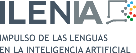

# OVOS Dialog Normalizer

A dialog transformer plugin for OpenVoiceOS (OVOS).

This plugin rewrites the written forms in a dialog into the words a speaker says, before the text goes to the text-to-speech (TTS) engine. A TTS engine reads letters, so `14:30`, `2,50 €` and `Dr.` must become words first.

## Examples

The plugin reads the language from the session of each dialog.

| Session language | Dialog | Text that goes to the TTS engine |
| --- | --- | --- |
| `pt-PT` | `O Dr. Silva pagou 2,50 € às 14:30.` | `O Doutor Silva pagou dois euros e cinquenta cêntimos às catorze e trinta.` |
| `en-US` | `I'm sure it's 5 km, not 12/03/2024.` | `I am sure it is five kilometers, not December third twenty twenty-four.` |
| `en-GB` | `We met on 12/03/2024.` | `We met on the twelfth of March twenty twenty-four.` |
| `gl-ES` | `Fai 25 ºC en Vigo.` | `Fai vinte e cinco graos centígrados en Vigo.` |

## How the plugin reads a dialog

The plugin gives the dialog and the full language tag of the session, such as `pt-BR` or `en-GB`, to [text2spoken](https://github.com/TigreGotico/text2spoken). text2spoken reads numbers, dates, times, money, units, symbols and abbreviations. The full tag selects the variety: `en-US` reads `12/03/2024` as December third, and `en-GB` reads it as the twelfth of March.

text2spoken does not expand contractions. For English, the plugin first expands contractions such as `I'm` and `can't`, and then gives the text to text2spoken.

If text2spoken fails on a dialog, the plugin logs a warning and sends the dialog to the TTS engine without changes.

## Languages

The plugin asks text2spoken which written forms a language reads, with `text2spoken.supports`. A language that has a text2spoken language file goes through text2spoken. text2spoken 0.0.2a53 has language files for Arabic, Basque, English, German, Portuguese, Russian and Spanish.

Other languages, such as Catalan, Dutch, French, Galician and Italian, use the fallback path:

- Digits become words through `ovos-number-parser`, with `unicode-rbnf` as the second choice.
- Titles such as `Sr.` and `Dott.ssa` become words.
- The `€` sign becomes `euros`.
- In Galician, `ºC` becomes `graos centígrados`.

When text2spoken adds a language file for a language, that language moves to text2spoken with no change to this plugin.

## Install

The plugin needs Python 3.11 or later. text2spoken publishes alpha releases, so pip needs the `--pre` option:

```bash
pip install --pre ovos-dialog-normalizer-plugin
```

To install from a source checkout, run this command in the checkout:

```bash
pip install --pre .
```

## Configuration

Add an entry under `"dialog_transformers"` in your `mycroft.conf` to enable the plugin.

```json
"dialog_transformers": {
    "ovos-dialog-normalizer-plugin": {}
}
```

## Related projects

- [TigreGotico/text2spoken](https://github.com/TigreGotico/text2spoken) reads the written forms. To improve a reading, contribute there.
- [OpenVoiceOS/ovos-number-parser](https://github.com/OpenVoiceOS/ovos-number-parser) reads digits in the fallback languages.
- [OpenVoiceOS/ovos-plugin-manager](https://github.com/OpenVoiceOS/ovos-plugin-manager) defines the `DialogTransformer` base class of this plugin.

## Contributing

Pull requests are welcome. Run the tests with `pytest test`.

## Credits

[TigreGotico](https://tigregotico.pt) developed this plugin for OpenVoiceOS under the [ILENIA](https://proyectoilenia.es) project.



> This plugin was funded by the Ministerio para la Transformación Digital y de la Función Pública and Plan de Recuperación, Transformación y Resiliencia. It was funded by the EU, NextGenerationEU, within the framework of the project [ILENIA](https://proyectoilenia.es), reference 2022/TL22/00215337.
